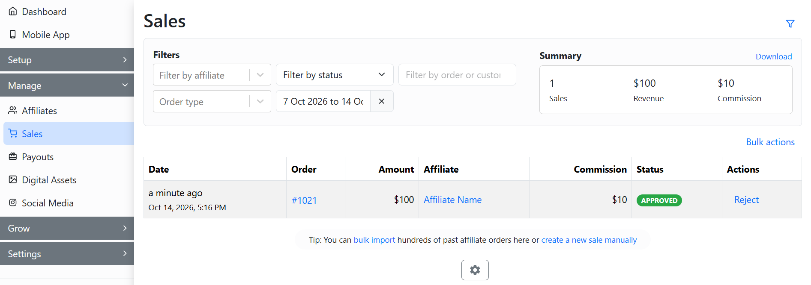

# Recalculate Commission

**GoAffPro** provides you with the option to recalculate commission on sales.

To recalculate commission on sales, go to the **Sales** tab in the GoAffPro admin panel.

<figure><figcaption>
Sales
</figcaption></figure>

Here, click on the **order number**.

<figure><figcaption>
Click on the order number
</figcaption></figure>

This will open up the order details window.

<figure><figcaption>
Order details
</figcaption></figure>

Now, click on **Recalculate Commission**.

<figure><figcaption>
Click on Recalculate Commission
</figcaption></figure>

Finally, click on **Update**.

<figure><figcaption>
Click on Update
</figcaption></figure>

The commission of the sale will be updated.&#x20;

<figure><figcaption></figcaption></figure>


Recalculate Commission

